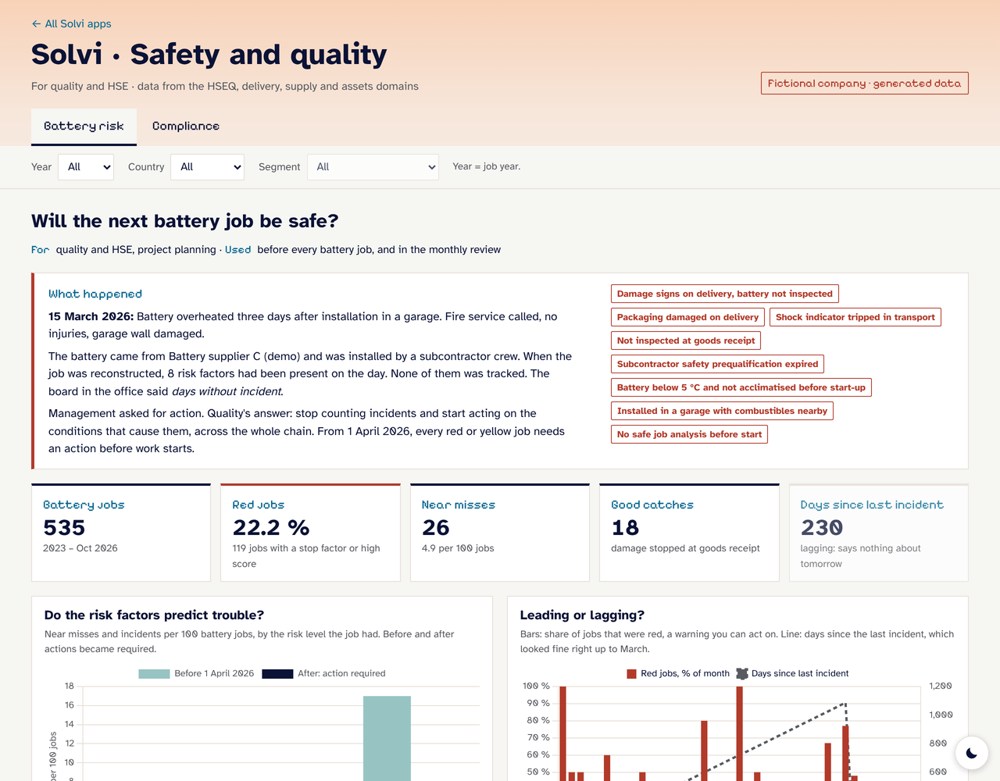
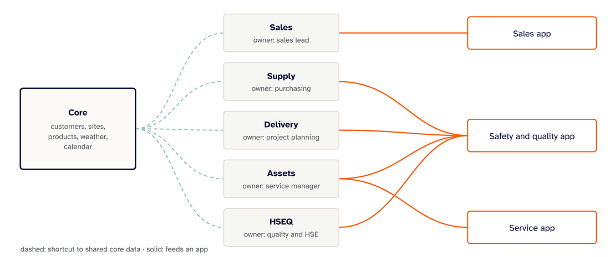

# Solvi

A data platform for a fictional solar and battery installer, built for Microsoft Fabric.
All data is generated. No real customers, companies or people.

**Live:** [unadata.dev/solvi](https://unadata.dev/solvi/)



## The story

In March 2026 a battery overheated three days after it was installed. Eight risk factors were present that day, and none were tracked. The office board said "days without incident".

Solvi's answer is to track the conditions before incidents happen. Each battery job gets a risk score from leading indicators, such as a damaged delivery, an expired subcontractor prequalification, a cold battery or a missing safe job analysis. Red and yellow jobs need an action before work starts.

The gold layer shows the effect. Before the rule, red jobs had about 17 events per 100 jobs. After, about 8.

## How it is built

Six domains, each with an owner, its own workspace and lakehouse, and its own quality gate. Shared data is read through OneLake shortcuts, never copied.



| Domain | Owner | Holds |
|---|---|---|
| core | data team | customers, sites, products, weather |
| sales | sales lead | proposals, orders, invoices, legacy ERP archive |
| supply | purchasing | suppliers, prequalification, battery deliveries |
| delivery | project planning | crews, certifications, jobs |
| assets | service manager | installations, daily production, service visits |
| hseq | quality and HSE | compliance, deviations, risk rules, HSE events |

Each domain runs three notebooks:

1. **Bronze:** raw CSV as it arrived, with load time and source file.
2. **Silver:** typed and checked. The quality gate tests keys, foreign keys across domains and value ranges. It stops the run if a check fails.
3. **Gold:** star schema for reporting, plus the risk model in hseq.

Three apps sit on top, one per user group: Safety and quality, Service, and Sales. Each app shows only what that group needs.

## Repo

| Folder | Contents |
|---|---|
| `generator/` | Makes the fictional data. Seeded, so every run gives the same result. |
| `notebooks/` | Fabric notebooks per domain, generated by `buildnotebooks.py`. `SHORTCUTS.md` lists the shortcuts. |
| `tools/` | Runs all 18 notebooks locally with PySpark. |
| `fabric/` | Builds everything in Fabric: workspaces, shortcuts, notebooks, pipelines and the semantic model. |
| `site/` | The website and apps on unadata.dev. |

## Run it

```
python generator/generate.py
python notebooks/buildnotebooks.py
python tools/runlocal.py
```

The last step needs PySpark. It uses parquet instead of Delta.

To build it in Fabric with one script, see [fabric/README.md](fabric/README.md).

## Next

- Run the Fabric build (the script, pipelines and Direct Lake model are ready in `fabric/`)
- Power BI report on the Solvi model, saved in this repo through Git integration
- Ontology and a Fabric data agent on top of the gold layer

Built by [Una Marie S. Goksøyr](https://unadata.dev). Code under the MIT licence.
